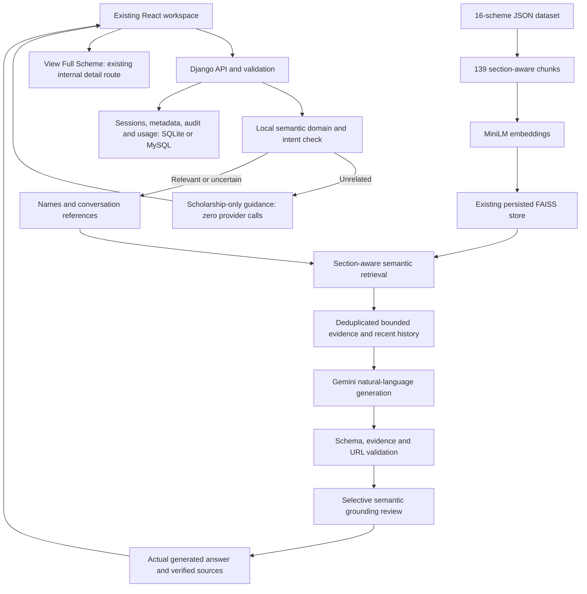

# Scholarship RAG architecture

RAG remains the factual engine: JSON -> embeddings/vector retrieval -> actual
retrieved text -> LLM -> answer/sources. Domain descriptions and section constraints
route information needs; they encode no scholarship eligibility rules or answers.
Existing API shapes, provider/model configuration, dataset and vector files remain.
Profile collection/matching remains removed. Application sections and source IDs
are preserved. Current verification and limits are in DEMO_READINESS.md.
