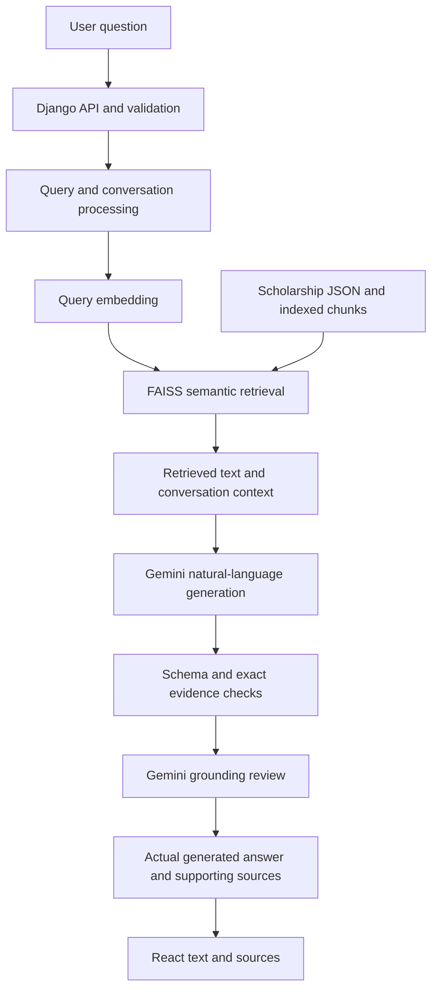

# Conversational RAG refactor report

Historical report for the earlier refactor (commit 2f14299). Current domain gating,
review policy, internal source navigation and measurements are in [DEMO_READINESS.md](DEMO_READINESS.md).

Verified on 2026-10-01 in D:/social-hackthon/social-hackthon, Windows, SQLite.
The existing application now retrieves scholarship evidence and displays Gemini's
actual generated answer. The personal-profile and deterministic matching workflow
has been removed. The existing visual design and scholarship data are preserved.

## Root cause and correction

Previously `backend/core/agent/workflow.py:answer_node` read model-selected exact
fragments and reconstructed the visible answer with scholarship names and raw
quotes. The model schema did not contain a natural-language answer field. Each
query also invoked the eligibility tool, and provider failures silently switched
to deterministic excerpts. This explains why tokens were consumed while the UI
still displayed source fragments and rule results.

The new model draft contains `answer`, `status`, and evidence-only `supports`.
After validation and a separate grounding review, the workflow passes `draft.answer`
to the API unchanged. React renders that same text. Evidence is returned separately.
Failures produce an explicit error and HTTP 503; no excerpt is presented as an AI answer.
A live Edge browser comparison confirmed that rendered text exactly equals the
actual Gemini-backed API response, including after reloading the conversation.

## 1. Files changed or created

- `.env.example`
- `README.md`
- `backend/schemas/assistant_response_schema.json`
- `backend/api/assistant.py`
- `backend/api/renderers.py`
- `backend/api/urls.py`
- `backend/api/views.py`
- `backend/apps/navigator/migrations/0002_remove_profiles_and_track_llm_phase.py`
- `backend/apps/navigator/models.py`
- `backend/config/settings.py`
- `backend/core/agent/tools.py`
- `backend/core/agent/workflow.py`
- `backend/core/corpus.py`
- `backend/core/llm.py`
- `backend/core/memory.py`
- `backend/core/rag/retrieval.py`
- `backend/core/schemas.py`
- `deploy/production.env.example`
- `docs/AGENT.md`
- `docs/API.md`
- `docs/ARCHITECTURE.md`
- `docs/AUDIT.md`
- `docs/DATASET.md`
- `docs/DEPLOYMENT.md`
- `docs/EVALUATION.md`
- `docs/RAG.md`
- `docs/RAG_REFACTOR.md`
- `docs/SECURITY.md`
- `docs/VERIFICATION.md`
- `evaluation/rag_cases.json`
- `evaluation/reports/focused_rag.json`
- `evaluation/reports/latest.json`
- `evaluation/reports/live_browser.json`
- `evaluation/reports/live_rag.json`
- `evaluation/run_eval.py`
- `frontend/e2e/navigator.spec.ts`
- `frontend/playwright.config.ts`
- `frontend/src/App.tsx`
- `frontend/src/Assistant.tsx`
- `frontend/src/Dashboard.tsx`
- `frontend/src/ScholarshipDetail.tsx`
- `frontend/src/ScholarshipList.tsx`
- `frontend/src/Workspace.tsx`
- `frontend/src/api.ts`
- `frontend/src/components.test.tsx`
- `frontend/src/components.tsx`
- `frontend/src/types.ts`
- `frontend/vite.config.ts`
- `scripts/verify_repository.py`
- `tests/conftest.py`
- `tests/test_agent.py`
- `tests/test_api.py`
- `tests/test_llm.py`
- `tests/test_rag.py`

The ignored private `.env` retains the working provider/key configuration; it is
not a tracked artifact. No scholarship JSON/JSONL/QA data or reference README was edited.

## 2. Files removed

- `backend/core/eligibility.py`
- `docs/ELIGIBILITY_ENGINE.md`
- `eligibility_engine.py`
- `evaluation/profiles.json`
- `frontend/src/ProfileForm.tsx`
- `student_profile_schema.json`
- `tests/test_eligibility.py`

The original initial database migration remains for migration-history compatibility.
Its historical profile model is deleted by the new migration, not imported by runtime code.

## 3. RAG components retained

- Authoritative `data/scholarship_dataset_ready.json`, 16 records, with original-record provenance.
- Original JSONL, combined corpus, QA report, and reference README.
- `backend/core/rag/documents.py`: section-aware document/chunk processing.
- `backend/core/rag/embeddings.py`: sentence-transformers/all-MiniLM-L6-v2 CPU embeddings.
- `backend/core/rag/vector_store.py`: persisted versioned FAISS index and metadata.
- Explicit ingestion command, 139 existing chunks, corpus/model integrity checks.
- Django/DRF API, LangGraph orchestration, bounded audited retrieval tool, private chat sessions.
- Gemini API integration, usage/token audit, and source provenance.

Corpus SHA-256: `805a64250c4e33f7d6e116d40cc2b054cb557fe6a69a6314d179a300929042ea`.
Existing ready index version: `faac7d4df3034bafae61db8e52553481`.
Eligibility criteria remain in the unchanged dataset and in the retrievable chunks.

## 4. RAG components modified

Semantic retrieval now favors distinct schemes for broad discovery and includes
retrieved schemes' important notes from the same vector store so source conflicts
are available to the model. Name/category metadata constraints remain query aids;
they never generate answers. The old section-keyword routing and lexical fallback
were removed. Index failure stops the answer with a clear error.

The graph is now plan -> retrieve -> answer. Context includes actual chunk text,
scheme names/sections, URLs where supplied, and user plus assistant history.
Generation produces natural language with exact evidence references. A second model
call checks the factual paraphrase, status, source relevance, and important notes.
A rejected answer may be regenerated once with specific review feedback.

## 5. Profile/rule components removed

Removed the profile form/route/navigation, saved browser profile, profile validation,
eligibility-check endpoint, rule tool/node/compiler/evaluator, matching cards,
profile payloads, profile schema, profile evaluation fixtures, and rule traces.
The new migration has been applied to local SQLite: the profile table is absent
and historical assistant messages no longer contain profile/eligibility/rule fields.
Saved conversation questions, answer text, and sources remain. Opening an old
profile URL redirects to the assistant. Voluntary details in chat can be discussed
against retrieved criteria; only the authority makes the final eligibility decision.

## 6. New request/response flow



`POST /api/agent/query` and `/api/rag/query` share this flow. Minimal payload:
`{"question":"How much does Pragati provide?"}`. Optional `session_id` uses the
existing private-session credential. Optional `context_scheme_id` supplies the
selected detail page; a newly named scheme can change the topic. Explicit
`scheme_ids` remains a deliberate hard retrieval filter.

Response fields: `answer`, `sources`, `status`, optional `error`, request/session IDs.
Status: `success`, `out_of_scope`, `insufficient_evidence`, or `error`. Missing facts
are explained without invented dates. Off-topic arithmetic is handled naturally by
the model with no scholarship citations. UTF-8 JSON headers prevent the previous
PowerShell currency/separator decoding problem.

## 7. LLM integration details

Configured live provider: Gemini; verified model: `gemini-3.5-flash-lite`.
The existing google-genai SDK uses `response_json_schema` for strict structured
output. The student-facing system prompt requires scholarship facts from retrieved
evidence, natural explanations, units/restrictions preserved, explicit missing
information, and both sides of relevant source conflicts. It prohibits internal
editorial/debug wording, invented links, and official award decisions.

Normal answers require two model calls: generation and semantic grounding review.
Both phases record real provider token usage separately. Validation checks evidence
quotes are contiguous text from actual retrieved chunks and URLs are supported.
The review must inspect every retrieved important-note chunk. One bounded repair
attempt is allowed; an optional configured fallback model is also genuinely generated.
Authentication, unavailable model, quota, timeout, invalid output, and retrieval
errors remain visible; keys and raw provider exceptions are never returned to React.

## 8. Retrieval flow

Resolve explicit names/categories and short follow-up references, expand the query
with discussed scheme names, embed it, and search persisted FAISS with metadata
constraints. Apply a similarity floor, diversify broad results, and retrieve
important notes for candidate schemes. Pass the resulting actual texts into the
model context. Default top_k is 8 (maximum 16), plus important notes. The context
budget removes oldest conversation messages first; excessive evidence requires a
narrower query instead of bypassing retrieval.

The Pragati -> 'How much does it provide?' live test passed. Discovery tests passed
for girls, postgraduate study, SC/ST, PhD, monthly support, and disability schemes.
These tests demonstrate the specified queries; discovery is not guaranteed exhaustive.

## 9. Source/evidence flow

The model returns source chunk IDs and exact supporting excerpts separately from
its answer. Backend resolves each ID exclusively against retrieved metadata and
returns scheme ID/name, source name/URL if supplied, original record key, retrieved
reference, and excerpt. Invalid references/quotes are rejected. React groups related
citations by scheme and displays relevant source names with safe links. Off-topic
answers have no sources. Source URLs absent from the dataset remain absent, with
an honest unavailable-link message. No official URLs are invented.

## 10. Environment variables required

Keep secrets only in ignored `.env`:

```dotenv
DJANGO_DEBUG=true
DJANGO_SECRET_KEY=your_private_local_secret
DB_ENGINE=sqlite
LLM_PROVIDER=gemini
LLM_MODEL=gemini-3.5-flash-lite
GEMINI_API_KEY=your_private_key
```

Existing settings and working key are retained. Index/model defaults:
`EMBEDDING_MODEL=sentence-transformers/all-MiniLM-L6-v2`,
`VECTOR_INDEX_DIR=var/index`. Generation defaults:
`LLM_TIMEOUT_SECONDS=30`, `LLM_MAX_INPUT_CHARS=24000`,
`LLM_MAX_OUTPUT_TOKENS=2400`; this workspace's existing output limit is 1800 and
was sufficient for the live tests. Optional fallback uses `LLM_FALLBACK_PROVIDER`,
`LLM_FALLBACK_MODEL`, `LLM_FALLBACK_API_KEY`. Unit/browser tests disable live calls.
Production MySQL additionally needs MYSQL_DATABASE/USER/PASSWORD/HOST/PORT and
production Django host/TLS settings; see `.env.example` and deployment documentation.

## 11. Commands to run backend/frontend

Backend terminal:

```powershell
cd D:\social-hackthon\social-hackthon
python backend/manage.py migrate
python backend/manage.py runserver 127.0.0.1:8000
```

Frontend terminal:

```powershell
cd D:\social-hackthon\social-hackthon
$env:PATH = "$PWD\var\tools\node-v24.21.0-win-x64;" + $env:PATH
npm.cmd --prefix frontend run dev
```

Open http://127.0.0.1:5173/#/assistant. Both existing servers were responding during
verification. The migration is already applied, the existing index is ready, and
no dependency reinstall or re-ingestion is necessary for this workspace. Fresh
checkout setup and ingestion commands remain in README.md.

## 12. Tests performed

```powershell
python -m pytest -q
python -m ruff check backend tests scripts evaluation
python -m ruff format --check backend tests scripts evaluation
python backend/manage.py check
python backend/manage.py makemigrations --check --dry-run
python backend/manage.py spectacular --validate --file var/openapi.yaml
python scripts/verify_repository.py
python evaluation/run_eval.py
python evaluation/run_eval.py --live --delay 20
python evaluation/run_eval.py --live --only missing_deadline --only application_contradiction --delay 20 --output evaluation/reports/focused_rag.json
npm.cmd --prefix frontend run lint
npm.cmd --prefix frontend run build
npm.cmd --prefix frontend test
npm.cmd --prefix frontend run e2e
```

Backend tests cover generated-text identity, exact source membership, unsupported
paraphrases rejected by review, bounded feedback repair, missing keys, model errors,
missing-fact citations, inspection of important notes, no profile endpoints,
UTF-8 response headers, semantic discovery, conversation state, index integrity,
and selected detail context changing to a newly named scheme.
Browser tests cover preserved browse/chat/source UI, explicit failure, and mobile layout.
A separate real Gemini browser check verified response identity, relevant sources,
no profile in the submitted request, and restored chat after page reload. Its
screenshot is `var/assistant-live.png` (ignored local artifact).

## 13. Test results

| Check | Observed result |
|---|---|
| Backend pytest | 43 passed |
| Ruff lint/format | Passed |
| Django check, migration drift, OpenAPI validation | Passed |
| TypeScript/ESLint and production build | Passed |
| Vitest | 7 passed |
| Headless Edge automated browser tests | 3 passed |
| Separate real Gemini browser round trip and reload | Passed |
| FAISS retrieval evaluation | 30/30 passed |
| Full paced live acceptance run | 14/16 passed |
| Focused rerun after correcting deadline status/source and conflict wording | 2/2 passed |
| Latest observed result for each of the 16 acceptance scenarios across those runs | 16 passed |
| Dataset, generated schema, repository hygiene | Passed |

The full live report retains its original failures; it was not rewritten to claim
a single 16/16 run. It caught a missing deadline source/status and insufficient
acknowledgment of conflicting application wording. Prompt/review corrections and
unit guards were added, then those two cases passed their focused live rerun.
Earlier unpaced experiments also exposed quota limits and a reviewer incorrectly
rejecting an authority disclaimer, which led to paced execution and corrected review.
The focused subprocess printed/saved 2/2 passed but its PowerShell wrapper returned
exit code 1; the persisted per-case results and passing checks are the acceptance evidence.

| Live scenario | Latest result | Evidence run |
|---|---|---|
| pragati_overview | PASS | Full live run |
| pragati_amount | PASS | Full live run |
| gate_criteria | PASS | Full live run |
| indira_documents | PASS | Full live run |
| girls_discovery | PASS | Full live run |
| conversation | PASS | Full live run |
| off_topic | PASS | Full live run |
| missing_deadline | PASS | Focused rerun |
| unsupported_amount | PASS | Full live run |
| income_contradiction | PASS | Full live run |
| application_contradiction | PASS | Focused rerun |
| postgraduate_discovery | PASS | Full live run |
| sc_st_discovery | PASS | Full live run |
| phd_discovery | PASS | Full live run |
| monthly_discovery | PASS | Full live run |
| disability_discovery | PASS | Full live run |

Reports: [retrieval](../evaluation/reports/latest.json),
[full live run](../evaluation/reports/live_rag.json),
[focused live rerun](../evaluation/reports/focused_rag.json),
[live browser check](../evaluation/reports/live_browser.json).
Live evidence checks and model review are not a proof of correctness for every paraphrase.

## 14. Remaining issues and limits

- SQLite was verified as requested; MySQL and Docker runtime acceptance remain pending.
- The supplied snapshot has missing official URLs, missing deadlines and real source
  contradictions. The assistant discloses these; current details require official verification.
- Grounding review can still miss a hallucination or reject a valid answer. It is a
  safeguard, not a guarantee. Broad discovery need not enumerate every relevant record.
- Two normal model calls add latency and consume quota. Rate/network/model errors
  are explicit; no silent deterministic answer fallback is provided.
- English MiniLM retrieval remains; multilingual retrieval quality was not established.
- Production TLS, database credentials, backups, retention and deployment security
  configuration still require the deployment environment described in docs/DEPLOYMENT.md.
- No Git remote is configured; work is local and has not been pushed.
